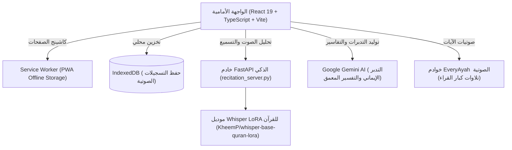

# 📖 مصحف المدينة الرقمي المطور (Digital Madinah Mushaf & AI Recitation Studio)

<div align="center">


<p align="center">
  <strong>تطبيق ويب تقدمي (PWA) متكامل لقراءة القرآن الكريم بالرسم العثماني الأصلي، مع نظام ذكاء اصطناعي متطور للتحقق من التسميع كلمة بكلمة، والتفسير والتدبر المعمق، وتسجيل التلاوات الشخصية مع دعم كامل دون اتصال بالإنترنت.</strong>
</p>

[](https://react.dev/)
[](https://www.typescriptlang.org/)
[](https://tailwindcss.com/)
[](https://vitejs.dev/)
[](https://fastapi.tiangolo.com/)
[](https://web.dev/progressive-web-apps/)
[](LICENSE)

</div>

---

## 📑 فهرس المحتويات (Table of Contents)

- [نظرة عامة (Overview)](#-نظرة-عامة-overview)
- [معرض الشاشات والمميزات (Visual Showcase)](#-معرض-الشاشات-والمميزات-visual-showcase)
- [المميزات الرئيسية (Core Features)](#-المميزات-الرئيسية-core-features)
  - [1. عرض المصحف الشريف بدقة متناهية](#1-عرض-المصحف-الشريف-بدقة-متناهية-authentic-mushaf-view)
  - [2. مساعد التسميع والتحقق الصوتي بالذكاء الاصطناعي](#2-مساعد-التسميع-والتحقق-الصوتي-بالذكاء-الاصطناعي-ai-recitation-verification)
  - [3. التفسير والتدبر الإيماني المعمق](#3-التفسير-والتدبر-الإيماني-المعمق-tafsir--ai-tadabbur)
  - [4. الاستماع لتلاوات كبار القراء](#4-الاستماع-لتلاوات-كبار-القراء-everyayah-audio-player)
  - [5. مسجل التلاوات الشخصية والأرشيف الصوتي](#5-مسجل-التلاوات-الشخصية-والأرشيف-الصوتي-personal-voice-studio)
  - [6. العمل دون اتصال بالإنترنت (PWA)](#6-العمل-دون-اتصال-بالإنترنت-offline--pwa)
  - [7. أنظمة الألوان والراحة البصرية](#7-أنظمة-الألوان-والراحة-البصرية-comfort-themes)
- [البنية التقنية والمعمارية (Architecture & Tech Stack)](#-البنية-التقنية-والمعمارية-architecture--tech-stack)
- [طريقة التشغيل والتثبيت (Installation & Setup)](#-طريقة-التشغيل-والتثبيت-installation--setup)
  - [تشغيل الواجهة الأمامية (Frontend App)](#تشغيل-الواجهة-الأمامية-frontend-app)
  - [تشغيل خادم الذكاء الاصطناعي (Whisper FastAPI Server)](#تشغيل-خادم-الذكاء-الاصطناعي-whisper-fastapi-server)
  - [التشغيل السحابي عبر Google Colab](#التشغيل-السحابي-عبر-google-colab)
- [هيكل المشروع (Directory Structure)](#-هيكل-المشروع-directory-structure)
- [مصادر البيانات والتراخيص (Data Sources & Credits)](#-مصادر-البيانات-والتراخيص-data-sources--credits)
- [الترخيص (License)](#-الترخيص-license)

---

## 🌟 نظرة عامة (Overview)

**مصحف المدينة الرقمي** هو منصة قرآنية حديثة ومتكاملة تم بناؤها لتجمع بين روعة المصحف الورقي المطبوع بمجمع الملك فهد لطباعة المصحف الشريف بالمدينة المنورة وأحدث تقنيات الويب والذكاء الاصطناعي لعام 2026.

يقدم التطبيق تجربة فريدة لحفظ ومراجعة القرآن الكريم، حيث يمكن للمستخدم إخفاء الآيات واختبار حفظه صوتياً عبر الذكاء الاصطناعي (نماذج Whisper المخصصة للقرآن الكريم)، بالإضافة للاطلاع الفوري على التفاسير الكلاسيكية واستلهام التدبرات الإيمانية، مع تسجيل التلاوات الشخصية والاحتفاظ بها محلياً دون الحاجة للاتصال بالإنترنت.

---

## 📸 معرض الشاشات والمميزات (Visual Showcase)

### تجربة قراءة غامرة ومتوافقة مع جميع الأجهزة

*واجهة متجاوبة تعمل بسلاسة فائقة على الحواسيب، الأجهزة اللوحية، والهواتف الذكية (iOS & Android)*

---

### نظام التسميع والتحقق الصوتي بالذكاء الاصطناعي

*تحقق فوري من التسميع كلمة بكلمة مع تلوين الكلمات المطابقة، كشف الأخطاء، وإحصائيات دقة النطق*

---

### التفسير والتدبر الإيماني لكل آية

*اطلاع سريع على أمهات كتب التفسير (ابن كثير، السعدي، الميسر) مع توليد الفوائد والتدبرات بذكاء اصطناعي رصين*

---

## ⚡ المميزات الرئيسية (Core Features)

### 1. عرض المصحف الشريف بدقة متناهية (Authentic Mushaf View)
- **مطابقة 100% لمصحف المدينة المنورة**: 604 صفحات كاملة برواية حفص عن عاصم.
- **نمطان للعرض**:
  - **نمط الصفحات المصورة (Image Mode)**: استخدام صفحات مجمع الملك فهد الأصلية عالية الدقة.
  - **نمط النص الرقمي التفاعلي (Interactive Text Mode)**: خطوط عثمانية أصيلة مع إمكانية التفاعل مع كل آية بالنقر (تفسير، استماع، نسخ).
- **عرض صفحتين متقابلتين (Double Page Mode)**: محاكاة تجربة المصحف الورقي المفتوح على الشاشات الكبيرة والحواسيب.
- **ترويسة وتذييل دقيق**: إيضاح اسم السورة، رقم الصفحة، رقم الجزء، الحزب، والربع في كل صفحة.

### 2. مساعد التسميع والتحقق الصوتي بالذكاء الاصطناعي (AI Recitation Verification)
- **فحص التلاوة كلمة بكلمة (Word-by-Word Matching)**: اعتماد نموذج `KheemP/whisper-base-quran-lora` المدرب خصيصاً على التلاوات القرآنية.
- **وضع إخفاء النص للاختبار (Memorization Testing)**: إخفاء نص الآيات مع إبقاء أرقامها، ليتسنى للقارئ التسميع غيباً، لتظهر الكلمات المتقنة تباعاً باللون الأخضر فور نطقها الصحيح.
- **مؤشرات دقيقة للأداء**:
  - 🟢 **كلمة صحيحة (Match)**: مطابقة تامة مع النص القرآني.
  - 🔴 **خطأ في النطق أو الكلمة (Mismatch)**: بيان الكلمة التي قرأها المستخدم والكلمة الصحيحة.
  - 🟡 **كلمة ناقصة (Missing)**: تنبيه في حال تجاوز آية أو كلمة.
- **لوحة نتائج ونسبة الدقة (Accuracy Score %)**: تقرير إحصائي مفصل بعد الانتهاء من التلاوة.

### 3. التفسير والتدبر الإيماني المعمق (Tafsir & AI Tadabbur)
- **مكتبة تفاسير موثوقة**:
  - تفسير ابن كثير
  - تفسير السعدي (تيسير الكريم الرحمن)
  - التفسير الميسر
  - تفسير الجلالين
- **التدبر الإيماني بالذكاء الاصطناعي**:
  - استنباط الهدايات والفوائد الإيمانية والتربوية لكل آية.
  - الإعجاز اللغوي والبلاغي.
  - إمكانية طرح أسئلة مخصصة حول الآية وتلقي إجابات مدعمة بالأدلة الشرعية.
- **ميزة البحث السريع**: بحث لحظي في نص القرآن الكريم وتفاسيره مع الانتقال المباشر.

### 4. الاستماع لتلاوات كبار القراء (EveryAyah Audio Player)
- الاستماع الفوري لتلاوة أي آية بضغطة زر واحدة.
- نخبة من كبار قراء العالم الإسلامي:
  - فضيلة الشيخ محمود خليل الحصري (مرتل ومجود)
  - فضيلة الشيخ عبد الباسط عبد الصمد
  - فضيلة الشيخ محمد صديق المنشاوي
  - فضيلة الشيخ مشاري بن راشد العفاسي
  - فضيلة الشيخ علي بن عبد الرحمن الحذيفي
  - فضيلة الشيخ سعود الشريم وماهر المعيقلي
- إمكانية تكرار الآية لتسهيل الحفظ والترديد.

### 5. مسجل التلاوات الشخصية والأرشيف الصوتي (Personal Voice Studio)
- **تسجيل تلاوة القارئ الشخصية** لكل صفحة على حدة عبر واجهة الميكروفون المدمجة.
- **مؤقت زمني ومحلل صوتي بصري (Visualizer Waves)** أثناء التسجيل.
- **تخزين محلي 100%**: حفظ التسجيلات في المتصفح عبر `IndexedDB` دون إرسال أي ملفات صوتية لسيرفر خارجي حفظاً للخصوصية.
- **أرشيف التسجيلات**: إدارة التلاوات المسجلة، الاستماع إليها، وإمكانية تحميلها كملفات صوتية عالية الجودة بصيغة WAV/WebM.

### 6. العمل دون اتصال بالإنترنت (Offline & PWA)
- **تطبيق تقدمي (PWA)** قابل للتثبيت كبرنامج مستقل على سطح المكتب (Windows / Mac) والهواتف الذكية (Android / iOS).
- **Service Worker متطور** يدعم استراتيجية `Cache-First` لتخزين صفحات المصحف والأصول الثابتة.
- **مدير التحميل دون اتصال (Offline Downloader)**: إمكانية تحميل أجزاء معينة أو المصحف كاملاً (604 صفحات) مسبقاً بضغطة زر واحدة للاستخدام في السفر أو الأماكن الخالية من التغطية.

### 7. أنظمة الألوان والراحة البصرية (Comfort Themes)
- **النمط النهاري العاجي (Ivory)**: يحاكي لون ورق المصحف الشريف الفاخر بأريحية تامة للعين.
- **النمط الدافئ (Sepia)**: للقراءة في الأجواء متوسطة الإضاءة.
- **النمط الليلي (Dark Mode)**: خلفية داكنة مريحة تمنع إجهاد العين أثناء التلاوة الليلية.
- **إبقاء الشاشة مضاءة (Wake Lock API)**: منع الشاشة من الانطفاء التلقائي أثناء قراءة الورد اليومي.

---

## 🏗 البنية التقنية والمعمارية (Architecture & Tech Stack)



| النطاق | التقنيات المستخدمة |
| :--- | :--- |
| **واجهة المستخدم** | React 19, TypeScript, Vite 6, Tailwind CSS 4, Motion, Lucide React |
| **الخطوط القرآنية** | خط عثمان طه، خط الرقعة، Amiri Quran، الخط العثماني القياسي |
| **إدارة الصوت والتسجيل** | Web Audio API, MediaRecorder API, HTML5 Audio |
| **التخزين والأوفلاين** | Progressive Web App (PWA), Service Worker, Cache API, IndexedDB |
| **خادم الذكاء الاصطناعي** | FastAPI, PyTorch, HuggingFace Transformers, PEFT LoRA, Uvicorn |
| **نموذج التعرف الصوتي** | `KheemP/whisper-base-quran-lora` (مخصص للقرآن الكريم) |
| **تفسير وتدبر الذكاء الاصطناعي** | Google Gemini 2.5 Flash API (@google/genai) |

---

## 🚀 طريقة التشغيل والتثبيت (Installation & Setup)

### متطلبات التشغيل (Prerequisites)
- **Node.js** (إصدار 18 فما فوق)
- **Python** (إصدار 3.10 فما فوق - في حال تشغيل خادم الذكاء الاصطناعي محلياً)
- كارت شاشة Nvidia يدعم CUDA (اختياري لتسريع Whisper AI محلياً)

---

### تشغيل الواجهة الأمامية (Frontend App)

1. **استنساخ المستودع وتثبيت الحزم**:
   ```bash
   git clone https://github.com/your-username/digital-madinah-quran.git
   cd digital-madinah-quran
   npm install
   ```

2. **إعداد المتغيرات البيئية**:
   قم بإنشاء ملف `.env` استناداً إلى `.env.example`:
   ```env
   # اختياري: مفتاح Gemini AI للتدبر المعمق
   GEMINI_API_KEY=your_api_key_here

   # رابط خادم الذكاء الاصطناعي للتسميع (الافتراضي محلياً)
   VITE_RECITER_API_URL=http://localhost:8000
   ```

3. **تشغيل خادم التطوير**:
   ```bash
   npm run dev
   ```
   افتح المتصفح على: `http://localhost:3000`

4. **بناء النسخة الإنتاجية**:
   ```bash
   npm run build
   npm run start
   ```

---

### تشغيل خادم الذكاء الاصطناعي (Whisper FastAPI Server)

إذا أردت تفعيل ميزة التسميع والتحقق الصوتي الذكي على جهازك:

1. **تثبيت حزم بايثون**:
   ```bash
   pip install -r requirements.txt
   ```

2. **بدء تشغيل سيرفر الـ FastAPI**:
   ```bash
   uvicorn recitation_server:app --host 0.0.0.0 --port 8000 --reload
   ```

3. سيعمل السيرفر ويقوم تلقائياً بتحميل أوزان الموديل `KheemP/whisper-base-quran-lora` المجهزة للقرآن الكريم.

---

### التشغيل السحابي عبر Google Colab

يوفر المشروع كراسة جاهزة `recitation_server.ipynb` لتشغيل خادم التسميع على كروت شاشة Google Colab المجانية (T4 GPU) وتوليد رابط سحابي عبر Ngrok أو LocalTunnel دون استهلاك موارد جهازك المحلي:
- افتح الملف `recitation_server.ipynb` في Google Colab.
- قم بتشغيل الخلايا للحصول على عنوان URL عام.
- ضعه في إعدادات التطبيق داخل نافذة "خادم التسميع".

---

## 📂 هيكل المشروع (Directory Structure)

```text
├── docs/
│   └── images/                # الصور التوضيحية والشاشات الخاصة بالتوثيق
├── public/
│   ├── QuranLogo.png          # شعار المصحف الشريف
│   ├── icon.svg               # أيقونة الـ PWA
│   ├── manifest.json          # إعدادات تثبيت الـ PWA
│   └── sw.js                  # مشغل الـ Service Worker للتخزين أوفلاين
├── src/
│   ├── components/
│   │   ├── Audio/             # مشغل صوتيات الآيات وكبار القراء
│   │   ├── Header/            # شريط التحكم العلوي والبحث والإعدادات
│   │   ├── MushafPage/        # عارض صفحات المصحف الشريف والنص التفاعلي
│   │   ├── Navigation/        # فهارس السور والأجزاء والانتقال السريع
│   │   ├── Offline/           # نافذة إدارة التحميل بدون إنترنت
│   │   ├── Recitation/        # أدوات التسميع وتحليل الصوت الذكي
│   │   ├── Recording/         # مسجل الصوت الشخصي وقاعدة بيانات التسجيلات
│   │   ├── Settings/          # تفضيلات المظهر والخطوط
│   │   └── Tafsir/            # نافذة التفسير المتعدد والتدبر
│   ├── data/                  # بيانات السور والأجزاء والقراء المعتمدين
│   ├── lib/                   # محركات IndexedDB، الاتصال بالسيرفر، وتوليد الصوت
│   ├── App.tsx                # نقطة الدخول والمكون الرئيسي
│   └── index.css              # تنسيقات Tailwind CSS والخطوط العثمانية
├── recitation_server.py       # خادم FastAPI للتعرف على التلاوة ونموذج Whisper
├── recitation_server.ipynb    # كراسة Colab لتشغيل الموديل سحابياً
├── server.ts                  # خادم Node.js / Express
└── package.json
```

---

## ⌨️ اختصارات لوحة المفاتيح والتنقل (Keyboard Shortcuts)

| المفتاح | الإجراء |
| :--- | :--- |
| `←` (السهم الأيسر) | الانتقال للصفحة التالية (تصفح عربي RTL) |
| `→` (السهم الأيمن) | الانتقال للصفحة السابقة |
| `Space` | إيقاف / متابعة التسجيل أو الصوت |
| `Esc` | إغلاق أي نافذة مفتوحة (الفهرس، التفسير، الإعدادات) |
| `F` | تفعيل وضع ملء الشاشة لقراءة خالية من المشتتات |

---

## 📜 مصادر البيانات والتراخيص (Data Sources & Credits)

- **نص وصفحات المصحف الشريف**: مجمع الملك فهد لطباعة المصحف الشريف بالمدينة المنورة.
- **فهارس الآيات والسور**: مستخرجة من قاعدة بيانات مشروع [Tanzil.net](https://tanzil.net/) المفتوحة.
- **التلاوات الصوتية لكبار القراء**: مستضافة عبر خوادم مشروع [EveryAyah.com](https://everyayah.com/).
- **نموذج الذكاء الاصطناعي للتلاوة**: نموذج `whisper-base-quran-lora` المبني على Hugging Face بواسطة مجتمع المطورين الإسلامي.
- **التفاسير الشرعية**: معتمدة من كتب التفسير المحققة برخص الاستخدام الدعوي غير التجاري.

---

## 🤝 المساهمة والتطوير (Contributing)

نرحب بكافة المساهمات والمقترحات لتطوير هذا الوقف الرقمي لخدمة كتاب الله!
1. قم بعمل Fork للمستودع.
2. أنشئ فرعاً لميزتك الجديدة (`git checkout -b feature/NewFeature`).
3. احفظ التعديلات (`git commit -m 'Add NewFeature'`).
4. ارفع التعديلات للفرع (`git push origin feature/NewFeature`).
5. أنشئ طلب دمج (Pull Request).

---

## ⚖️ الترخيص (License)

هذا المشروع وقف رقمي خالص ومتاح للاستخدام والنشر تحت رخصة مفتوحة المصدر لخدمة الإسلام والمسلمين، ولا يجوز استخدامه في أي غرض تجاري يخالف روح الوقفية.

<div align="center">
  <sub>اللهم اجعل القرآن العظيم ربيع قلوبنا، ونور صدورنا، وجلاء أحزاننا، وذهاب همومنا.</sub>
</div>
