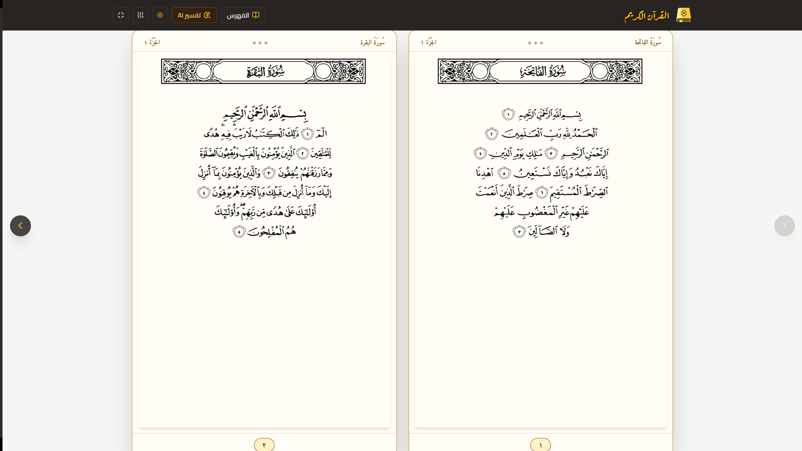
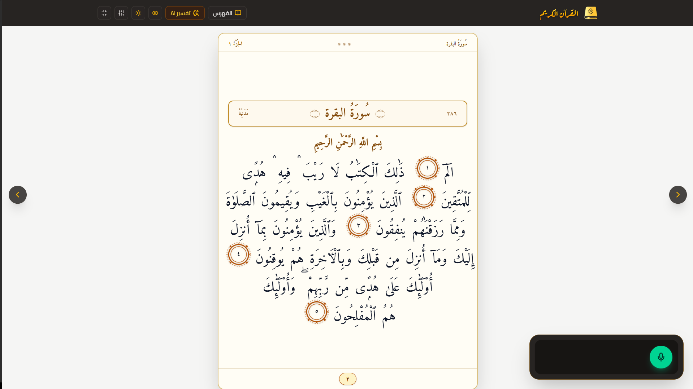
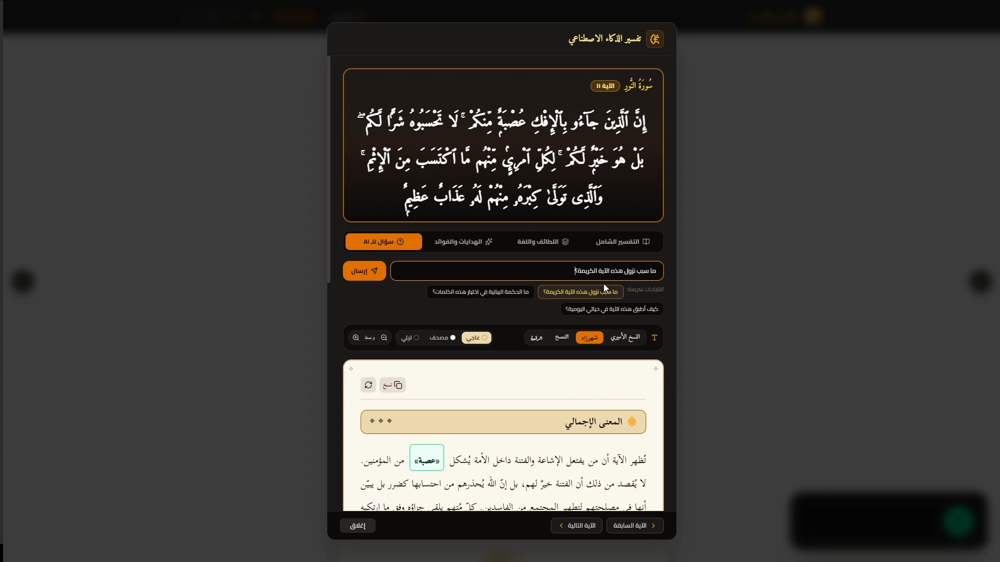
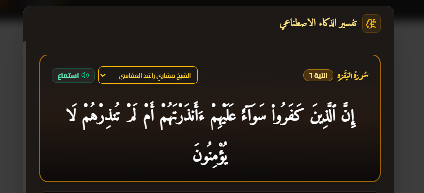
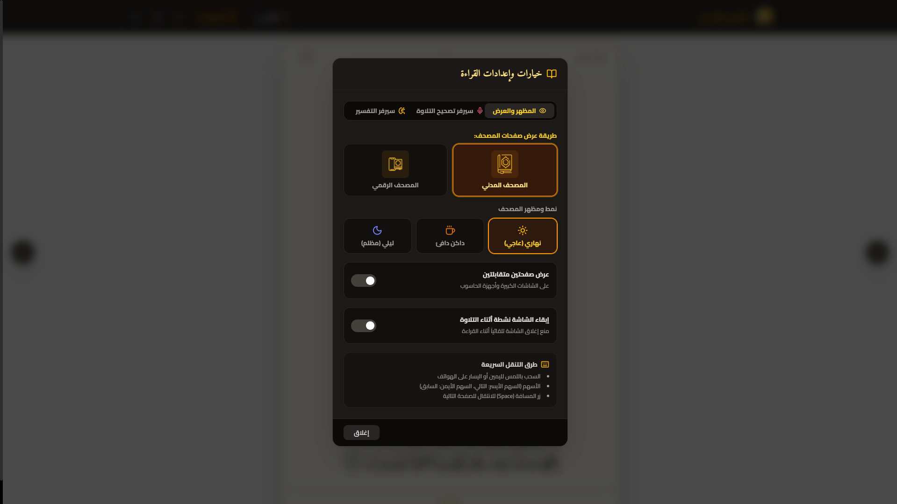
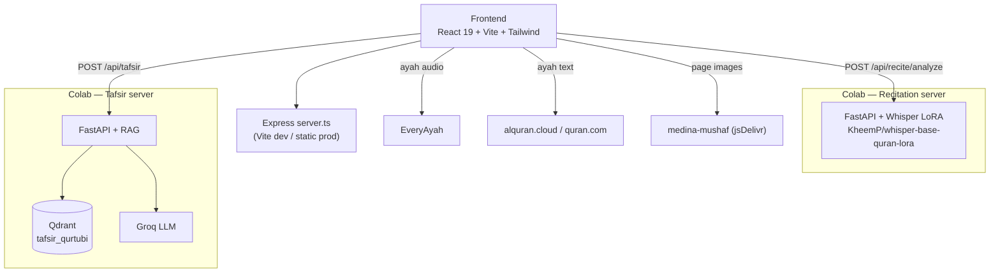

<div align="center">

# مصحف المدينة الرقمي — AI Recitation App

**مصحف تفاعلي لقراءة القرآن الكريم وحفظه، مع تسميع بالذكاء الاصطناعي كلمة بكلمة، وتفسير مبني على RAG.**


[نظرة عامة](#نظرة-عامة) · [لقطات الشاشة](#لقطات-الشاشة) · [المميزات](#المميزات) · [Getting Started](#getting-started) · [API Reference](#api-reference)

</div>

---

## Table of Contents

**المنتج**
- [نظرة عامة](#نظرة-عامة)
- [لقطات الشاشة](#لقطات-الشاشة)
- [المميزات](#المميزات)

**Developer Guide**
- [Tech Stack](#tech-stack)
- [Architecture](#architecture)
- [Getting Started](#getting-started)
- [AI Servers Setup (Google Colab)](#ai-servers-setup-google-colab)
- [Configuration](#configuration)
- [API Reference](#api-reference)
- [Project Structure](#project-structure)
- [Keyboard Shortcuts](#keyboard-shortcuts)
- [Troubleshooting](#troubleshooting)
- [Acknowledgments](#acknowledgments)
- [License](#license)

---

## نظرة عامة

تطبيق ويب يعرض صفحات **مصحف المدينة المنورة** (604 صفحات، رواية حفص عن عاصم)، ويضيف فوقها أدوات تساعد على الحفظ والمراجعة:

- **تسميع بالذكاء الاصطناعي:** تتلو الصفحة، فيحوّل نموذج **Whisper** المخصص للقرآن صوتك إلى نص، ثم تُقارَن الكلمات بنص الصفحة ويُلوَّن كل منها (صحيحة / خاطئة / ناقصة).
- **تفسير ذكي:** يستند إلى **تفسير القرطبي** عبر **RAG**: بحث دلالي في **Qdrant**، ثم توليد الإجابة بنموذج لغوي عبر **Groq**. وتتوفر أنماط: تفسير عام، لغوي وبلاغي، هدايات ودروس، أو سؤال حر عن الآية.
- **استماع للآية:** تشغيل أي آية بصوت كبار القراء من **EveryAyah** بضغطة واحدة، مع اختيار القارئ وتكرار الآية للمساعدة على الحفظ.

> **ملاحظة:** الواجهة الأمامية وحدها تكفي لعرض المصحف والاستماع للقراء. أما **التسميع** و**التفسير** فيحتاجان تشغيل خادمين من نوع `FastAPI` عبر الملفات الموجودة في `notebooks/`، وتفاصيل ذلك في قسم [AI Servers Setup](#ai-servers-setup-google-colab).

> **تنبيه:** نتائج التسميع أداة مساعدة للمراجعة الذاتية، ولا تغني عن التلقي من معلّم متقن لأحكام التجويد.

---

## لقطات الشاشة

### 1. Image Mode — عرض المصحف

<p align="center">
  
</p>

صفحات مصحف المدينة الأصلية بجودة عالية، مع شريط علوي للتنقل بين الصفحات والفهرس وتبديل أوضاع العرض.

### 2. Text Mode — النص التفاعلي

<p align="center">
  
</p>

نص عثماني قابل للنقر؛ اضغط على أي آية لتشغيلها صوتيًا أو فتح تفسيرها.

### 3. Recitation Mode — التسميع

<table align="center">
  <tr>
    <td align="center" width="50%">
      
    </td>
    <td align="center" width="50%">
      
    </td>
  </tr>
</table>

اضغط تسجيل وابدأ التلاوة، فتُلوَّن كل كلمة حسب صحة نطقها.

### 4. Tafsir — نافذة التفسير

<p align="center">
  
</p>

تفسير الآية من القرطبي بأربعة أنماط: عام، لغوي وبلاغي، هدايات ودروس، أو سؤال حر.

### 5. Ayah Player — الاستماع للقراء

<p align="center">
  
</p>

اختر القارئ من بين 23 تلاوة، وكرّر الآية للمساعدة على الحفظ.

### 6. Settings — الإعدادات

<p align="center">
  
</p>

تبديل النمط البصري بين Light وSepia وDark، وإدخال روابط خوادم التسميع والتفسير.

---

## المميزات

### عرض المصحف
- **604 صفحات** من مصحف المدينة برواية حفص عن عاصم.
- **وضعان للعرض:** صور الصفحات بوضع **Image Mode**، أو نص عثماني تفاعلي بوضع **Text Mode** يمكن النقر فيه على أي آية.
- **عرض صفحتين متقابلتين** على الشاشات الكبيرة، بوضع **Double Page**.
- **ثلاثة أنماط ألوان:** Light، Sepia، Dark.
- **فهرس** للسور والأجزاء، وحفظ آخر صفحة وصلت إليها تلقائيًا.
- **منع انطفاء الشاشة** عبر **Wake Lock**، مع **وضع ملء الشاشة** أثناء القراءة.
- تنقل بالسحب على الهاتف، وبلوحة المفاتيح على الحاسوب.

### التسميع بالذكاء الاصطناعي
- نموذج `KheemP/whisper-base-quran-lora` المبني على **Whisper** مع **LoRA** لتحويل التلاوة إلى نص.
- **مطابقة كلمة بكلمة** مع نص الصفحة عبر خوارزمية محاذاة (`alignment.ts`) مع تطبيع النص القرآني (إزالة التشكيل وتوحيد الحروف).
- **وضع الحفظ:** إخفاء نص الآيات مع إبقاء أرقامها، وتظهر الكلمات الصحيحة فور نطقها.
- **ثلاثة أنماط لإرسال الصوت للخادم:** دوري `periodic`، عند التوقف `pause`، أو يدوي `manual`.

### التفسير من القرطبي
- بحث دلالي في **Qdrant** باستخدام نموذج التضمين `intfloat/multilingual-e5-large` بأبعاد 1024، ومقياس التشابه **cosine**.
- توليد الإجابة عبر **Groq** اعتمادًا على مقتطفات القرطبي المسترجعة فقط؛ وإن لم يوجد نص مناسب يُنبَّه المستخدم أن الإجابة ليست من القرطبي مباشرة.
- أنماط الطلب: `general` · `linguistic` · `lessons` · `custom_question`.
- تنسيق الإجابة بعناوين وقوائم، مع خيارات للخط وحجمه وخلفية القراءة، ونسخ النص ونطقه.
- عند تعذر الاتصال بالخادم يعرض التطبيق نصًا احتياطيًا بدل أن يفشل.

### الاستماع للقراء
- تلاوة أي آية بضغطة واحدة من **EveryAyah**، مع **23 تلاوة** لعدد من كبار القراء (العفاسي، الحصري، المنشاوي، عبد الباسط، المعيقلي، السديس، الشريم، الغامدي، ياسر الدوسري، وغيرهم).
- تكرار الآية للمساعدة على الحفظ، وتذكّر القارئ المفضل.

---

## Tech Stack

| Layer | Technologies |
| :-- | :-- |
| Frontend | React 19, TypeScript 5.8, Vite 6, Tailwind CSS 4, Motion, Lucide React |
| Local server | Node.js + Express (`server.ts`) — serves Vite in dev and `dist/` in production |
| Audio | Web Audio API, MediaRecorder API, HTML5 Audio |
| Storage | localStorage (settings) |
| Recitation (ASR) | FastAPI, PyTorch, Transformers, PEFT (LoRA), librosa, soundfile |
| Tafsir (RAG) | FastAPI, Sentence-Transformers, Qdrant, Groq |
| Server hosting | Google Colab (T4 GPU) + Cloudflare Tunnel / ngrok |

---

## Architecture



**Recitation flow:** record audio (`RecordingBar`) → send to the server → Whisper transcription → word alignment against the page text (`alignment.ts`) → word coloring.

---

## Getting Started

### Prerequisites

- **Node.js** 18+
- A **Google Colab** account to run the AI servers (optional if you only need the Mushaf reader)

### Install and run

```bash
git clone https://github.com/Anasrefay/AI-Recitation-app.git
cd AI-Recitation-app
npm install
cp .env.example .env
npm run dev
```

Open **http://localhost:3000**.

### Production build

```bash
npm run build   # vite build + bundles server.ts into dist/server.cjs
npm run start   # runs the built server from dist/
```

### npm scripts

| Script | Description |
| :-- | :-- |
| `npm run dev` | Start Express + Vite (`tsx server.ts`) on port 3000 |
| `npm run build` | Production build |
| `npm run start` | Run the production build |
| `npm run lint` | Type check (`tsc --noEmit`) |
| `npm run clean` | Remove `dist` |

---

## AI Servers Setup (Google Colab)

Both servers live inside the notebooks. Each one runs on Colab, is exposed through a public URL, and that URL is pasted into the app settings.

### Recitation server — `notebooks/recitation_server.ipynb`

1. Open the notebook in Colab, then **Runtime → Change runtime type → T4 GPU**.
2. Run the cells **in order**: GPU check → install dependencies (ffmpeg + Python packages) → load the model (LoRA merged into the weights, float16) → define the API → start uvicorn.
3. Get a public URL with **Cloudflare Tunnel** (cell 6.3, recommended), LocalTunnel, or ngrok.
4. In the app: **Settings → Recitation server**, then paste the URL (stored in `localStorage`).

### Tafsir server — `notebooks/tafsir_qurtubi.ipynb`

1. Add these keys to **Colab Secrets**: `QDRANT_URL`, `QDRANT_API_KEY`, `GEMINI_API_KEY`, `GROQ_API_KEY`, `NGROK_TOKEN` (the notebook reads all of them via `userdata.get`).
2. **One time only:** upload the Tafsir al-Qurtubi JSON (e.g. from [QUL](https://qul.tarteel.ai/resources/tafsir)). It is chunked, embedded, and upserted into a Qdrant collection named `tafsir_qurtubi`.
3. Run the server cell and the **ngrok** cell, then copy the printed URL.
4. In the app: **Settings → Tafsir server**, then paste the URL.

> **Warning:** Free Colab tunnels (ngrok / Cloudflare quick tunnel) **change on every run** and stop when the notebook closes. For permanent use, deploy both servers to a host such as Render or Railway.

> **Tip:** To run the recitation server locally, `requirements.txt` lists its packages (`fastapi`, `uvicorn`, `torch`, `transformers`, `peft`, …). Export the server code from the notebook to a `.py` file and run it with `uvicorn`.

---

## Configuration

Copy `.env.example` to `.env`:

| Variable | Used by | Description |
| :-- | :-- | :-- |
| `GEMINI_API_KEY` | Frontend / tafsir notebook | Gemini API key (injected at runtime by AI Studio) |
| `APP_URL` | Frontend | Where the app is hosted (e.g. `http://localhost:3000` locally) |
| `QDRANT_URL` / `QDRANT_API_KEY` | Tafsir notebook | Qdrant Cloud connection |
| `GROQ_API_KEY` | Tafsir notebook | Groq key for answer generation |
| `NGROK_TOKEN` | Tafsir notebook | Exposes the server through a public URL |

> **Caution:** `.env` is git-ignored. Never commit your API keys.

---

## API Reference

### Recitation server (FastAPI)

| Method | Path | Description |
| :-- | :-- | :-- |
| `GET` | `/`, `/health` | Server and GPU status |
| `POST` | `/api/recite/analyze` | Analyze a full recording or chunks. `multipart` fields: `audio`, `page_number`, `reference_text` |
| `WS` | `/ws/recite` | Live stream: client sends PCM int16 / 16 kHz / mono, server replies with `partial` and `final` messages |

Optional WebSocket query params: `?vad=0.01&step=0.7&silence=0.8&max_seg=25`

Real-time tuning constants (top of the API cell):

| Constant | Default | Meaning |
| :-- | :-- | :-- |
| `STEP_S` | `0.7` | Seconds of new audio between `partial` updates |
| `END_SILENCE_S` | `0.8` | Silence that ends a segment and emits `final` |
| `MAX_SEG_S` | `25` | Max segment length (Whisper limit is 30 s) |
| `VAD_RMS` | `0.010` | Energy threshold for voice activity detection |

### Tafsir server (FastAPI)

| Method | Path | Description |
| :-- | :-- | :-- |
| `GET` | `/health` | Health check |
| `POST` | `/api/tafsir` | Request an ayah tafsir (surah, ayah number, text, mode, optional question) |

RAG settings: `SCORE_THRESHOLD = 0.5`, up to `MAX_CONTEXT_HITS = 3` retrieved passages, each truncated to `MAX_CHARS_PER_HIT = 800`.

### Local Express server

| Method | Path | Description |
| :-- | :-- | :-- |
| `GET` | `/api/health` | App server health check |
| `POST` | `/api/recite/stream-chunk` | Placeholder endpoint that returns an empty transcription |

---

## Project Structure

```text
AI-Recitation-app/
├── notebooks/
│   ├── recitation_server.ipynb   # Whisper LoRA + FastAPI + WebSocket server
│   └── tafsir_qurtubi.ipynb      # Qurtubi → Qdrant indexing + tafsir server
├── public/
│   ├── screenshots/              # README screenshots
│   ├── manifest.json             # Web app manifest
│   └── icon.svg, QuranLogo.png   # Icons and logo
├── src/
│   ├── App.tsx                   # Root component and state
│   ├── components/
│   │   ├── Audio/                # Ayah audio player and reciters
│   │   ├── Header/               # Top bar
│   │   ├── MushafPage/           # Page viewer (image / text)
│   │   ├── Navigation/           # Index modal and page navigator
│   │   ├── Recitation/           # Recitation settings
│   │   ├── Recording/            # Recording bar
│   │   ├── Settings/             # Settings and themes
│   │   └── Tafsir/               # Tafsir modal
│   ├── data/                     # Surahs, juz, reciters, page metadata
│   └── lib/
│       ├── recitation/           # Server client + word alignment + types
│       ├── recording/            # MediaRecorder (audio capture)
│       ├── fastapi-tafsir.ts     # Tafsir server client
│       ├── quran-verses.ts       # Ayah text fetching
│       └── quran-data.ts         # Page image sources
├── server.ts                     # Express (Vite middleware / static files)
├── requirements.txt              # Python deps for the recitation server
├── .env.example
└── package.json
```

---

## Keyboard Shortcuts

| Key | Action |
| :-- | :-- |
| `←` | Next page (RTL reading) |
| `→` | Previous page |
| `Space` / `PageDown` | Next page |
| `PageUp` | Previous page |
| `Esc` | Close the ayah audio player |

---

## Troubleshooting

| Problem | Fix |
| :-- | :-- |
| App can't reach the recitation server | Make sure the server cell is still running in Colab and the URL in Settings is up to date (free tunnel URLs change) |
| Microphone not working | Grant the browser microphone permission; **HTTPS** or `localhost` is required |
| Server is very slow | Check that `CUDA Available: True` in the GPU check cell |
| LocalTunnel password page | Use Cloudflare Tunnel (cell 6.3) — it supports WebSocket and needs no password |
| Tafsir shows fallback text | The tafsir server is unreachable; run the notebook and update the URL in Settings |

---

## Acknowledgments

- **Page images:** [medina-mushaf](https://github.com/sufone/medina-mushaf), served via jsDelivr.
- **Ayah text:** [AlQuran Cloud](https://alquran.cloud/) and the [Quran.com API](https://quran.com/).
- **Audio recitations:** [EveryAyah](https://everyayah.com/).
- **Recitation model:** [`KheemP/whisper-base-quran-lora`](https://huggingface.co/KheemP/whisper-base-quran-lora), built on OpenAI Whisper.
- **Tafsir al-Qurtubi data:** [QUL — Tarteel](https://qul.tarteel.ai/resources/tafsir).
- **Embeddings:** [`intfloat/multilingual-e5-large`](https://huggingface.co/intfloat/multilingual-e5-large).

---

## License

Source files carry an **Apache-2.0** license header. Third-party data, images, and audio listed above remain subject to their owners' licenses — review them before any commercial use.

<div align="center">
  <sub>اللهم اجعل القرآن العظيم ربيع قلوبنا ونور صدورنا.</sub>
</div>